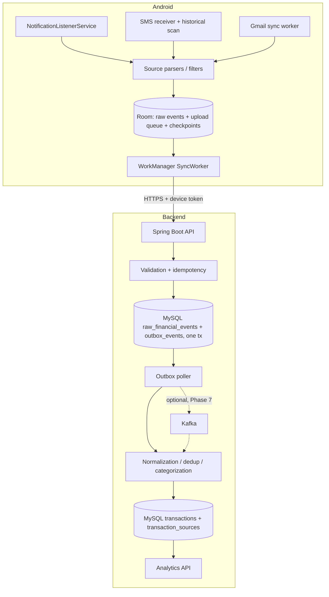

# Architecture

## Principles
- Android is the first durable receiver. An event is deleted/archived locally only per retention policy after a valid backend ack.
- MySQL is the single source of truth. Kafka carries events; it never stores the record.
- Modular monolith. No microservices, Redis, Elasticsearch or MongoDB.
- AI is deferred and never on the collection/normalization path.

## Components

## Event flow
1. Android receives event, filters (no OTP/auth content), saves to Room with status PENDING.
2. Android enqueues a unique WorkManager upload (network constraint; backoff with jitter). Timing is best-effort, never exact.
3. Backend authenticates device, validates, checks `(device_id, source_type, source_event_id)` idempotency, inserts raw event + outbox row in one transaction, returns ACCEPTED / DUPLICATE / REJECTED, or 503 if the DB write failed.
4. Android marks SYNCED only on ACCEPTED or DUPLICATE.
5. Outbox poller drives normalization in-process; Kafka publishing is added as an extra sink in Phase 7. Ack means "stored", not "normalized"; processing status is exposed separately.

## Failure recovery
| Failure | Behavior |
|---|---|
| No internet / backend down | Events stay in Room; retry with exponential backoff + jitter |
| MySQL down | API returns 503 (retriable); no false ack |
| Kafka down / idle shutdown | Ingestion unaffected; outbox rows stay pending and are retried |
| Parser failure | Evidence kept, NEEDS_REVIEW, parser version recorded, reprocessable |
| Duplicate upload | Unique constraint + idempotent ack |
| Process killed / reboot | Room + persisted WorkManager; listener rebind; boot check |
| Permission revoked / OAuth expired | Source marked PERMISSION_REQUIRED / DISCONNECTED, user warned |

## Infrastructure constraints (verified Nov 2026)
- Aiven MySQL free tier is retired for new services; the existing running service is used. Keep a tested export/restore path.
- Aiven Kafka free: up to 5 topics x 2 partitions, 250 KiB/s, idle shutdown, no SLA.
- Gmail `gmail.readonly` in "Testing" status: refresh tokens expire after 7 days.
- Oracle Always Free capacity and idle reclamation are not guaranteed (Phase 9).
